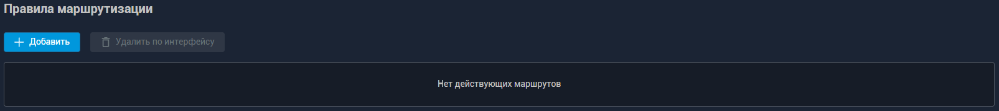
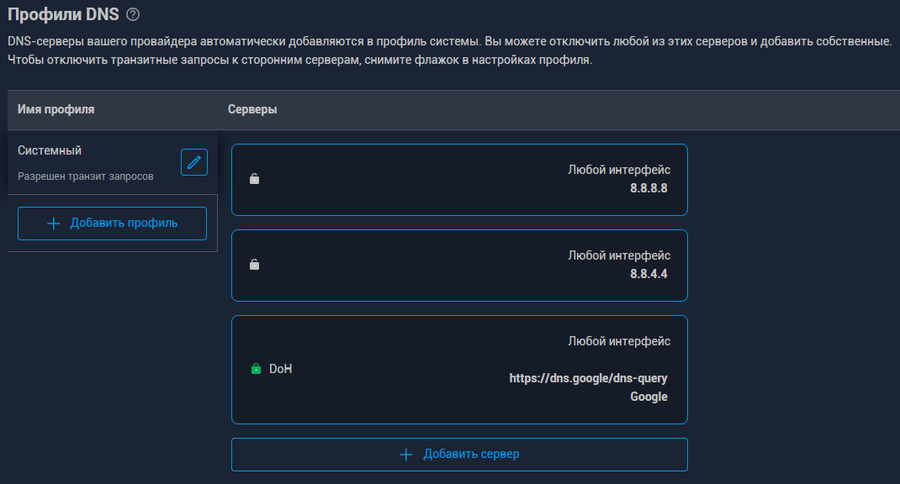

# Susanin.Keenetic

**Адаптивная VPN-маршрутизация для KeeneticOS (Entware) · Adaptive VPN routing for KeeneticOS · 面向 KeeneticOS 的自适应 VPN 路由**

[](src)
[](README.md)
[](README.md)
[](README.md)
[](LICENSE)
[](https://github.com/R17a/Susanin.Keenetic/releases)

[](https://pay.cloudtips.ru/p/dcbf5f2e)
[](https://www.donationalerts.com/r/dmitriy_r17a)
[](https://t.me/Susanin_Keenetic)

<hr>

## 🇷🇺 Русский

Проект сделан по [статье на Habr](https://habr.com/ru/articles/1076620/) и проекту
[Fiark/susanin](https://github.com/Fiark/susanin) (адаптивная VPN-маршрутизация для
MikroTik RouterOS), перенесён на роутеры Keenetic/Entware.

Адаптивная маршрутизация: программа смотрит, какие соединения «не работают» из-за
блокировок, пробует их через VPN, запоминает рабочие и дальше держит их в VPN. Если
VPN недоступен — всё идёт напрямую. Есть и простой список доменов, которые должны
идти через VPN **всегда** (без ручных списков IP — только имена, как в Keenetic).

**Статус: релиз 0.5.4.** Поддерживается и проверяется на Keenetic Viva (MT7621, MIPS),
KeeneticOS 5.1.4–5.1.5, Entware, туннели WireGuard/AmneziaWG (`nwg0`/`nwg1`),
Xray VLESS+REALITY и VLESS+WS+TLS (`egress_type=tproxy`), Keenetic Giga/Ultra.

**Что делает**

- наблюдает за поведением соединений (conntrack), а не за содержимым;
- по «тихим» признакам блокировок (TCP SYN без ответа, QUIC/UDP без reply,
  TCP-stall, DPI-RST) проверяет адрес через VPN и запоминает результат;
- держит подтверждённые направления в VPN с конечным TTL (`ok_ttl`, 6 ч) и снимает
  их сам, если через VPN перестало отвечать;
- списки «всегда через VPN» и «всегда напрямую»: домены, wildcard `*.example.com`,
  CIDR, IP; в списке «всегда через VPN» работает и мягкая запись `?домен` — по
  умолчанию напрямую, в VPN адрес уходит, когда прямой путь деградировал;
- fail-open (нет туннеля — прямой доступ), failover между несколькими VPN и
  автоматический возврат на приоритетный;
- egress — интерфейс (`nwg*`, `wdtt*`), Xray/VLESS+REALITY (`egress_type=tproxy`)
  или собственный сервер AY (`egress_type=ay`);
- профили маршрутизации: до 4 списков «домены/CIDR → свой туннель»;
- встроенная веб-панель (только LAN) с интерфейсом на русском, английском и
  китайском; по умолчанию выключена;
- сам восстанавливает правила, если их снёс NDM, и умеет маршрутизировать клиентов
  OpenConnect-сервера на этом же роутере;
- **P5: вывод стороннего прокси в туннель.** Если на роутере поднят MTProxy
  (например [Teleproxy.Keenetic](https://github.com/R17a/Teleproxy.Keenetic)),
  его исходящий трафик метится по uid процесса и уходит в `proxy_egress`
  (`nwg0`), не пересекаясь с LAN-маршрутизацией. Прокси работает под
  непривилегированным пользователем, без SOCKS и без `ip route` в main-таблице;
- DNS-снифинг: связывает IP с доменом из DNS-ответа — списки применяются
  мгновенно, а `susanin why <ip|домен>` и лог обучения показывают, почему адрес
  идёт именно так;
- детект «заморозки» ТСПУ (обрыв TCP-потока после первых десятков пакетов) и
  наследование вердикта на всю /24-сеть хостинга — новые IP заблокированной
  сети уходят в VPN без проб;
- RU-guard: российские домены (`.ru`, `.рф` и др.) автообучение в VPN не
  заворачивает — антифрод банков и маркетплейсов режет чужой выход;
- UDP/QUIC через туннель (встроенный SOCKS-UDP-релей) и авто-обновление
  диапазонов CDN.

Не является клиентом чужого VPN: туннель (WireGuard/AmneziaWG «Дополнительное
подключение») должен уже работать — либо поднимите свой сервер AY (см. ниже).
IPv6 в v1 не поддерживается.

**AY: свой сервер вместо VPN.** Отдельный тип egress — агент поднимает собственный
tun (`ay0`) и держит сессию с сервером Susanin.Keenetic.AY, без WireGuard и без
Xray. В панели **VPN / Egress → Susanin.Keenetic.AY** вписываются адрес сервера и
ключ, затем **Тип egress** = `ay`: признанный «через VPN» трафик уходит в этот
туннель. Сервер под Ubuntu x86-64 идёт в комплекте пакета
(`/opt/susanin/ay-server`) и отдельным архивом в релизе; транспорт поставляется
бинарником. Параметры, ограничения и диагностика — [docs/AY.md](docs/AY.md).

**Требования**

- Keenetic с Entware; пакеты `ipset`, `iptables`, `conntrack`,
  `ca-certificates` + `wget-ssl`;
- работающий VPN-туннель (WireGuard/AmneziaWG), Xray/VLESS+REALITY или собственный
  сервер AY;
- в Keenetic **выключена «Маршрутизация DNS»**, включён шифрованный DNS (DoH/DoT) —
  иначе возможны подмена DNS и «YouTube/Claude не открывается».

  
  

**Быстрый старт**

```sh
opkg update && opkg install ca-certificates wget-ssl
wget -qO- https://raw.githubusercontent.com/R17a/Susanin.Keenetic/main/install.sh | sh -s -- --ipk
susanin version && susanin status && susanin diagnose
```

**Веб-панель (только LAN):** `web_enable=1`, `web_listen=192.168.1.1`,
`web_port=8087` в `/opt/susanin/etc/susanin.conf`, затем
`sh /opt/susanin/tools/susanin.sh web restart` → `http://192.168.1.1:8087/`.
Язык интерфейса — в шапке справа: русский (по умолчанию), английский, китайский.

**Документация**

- [USER_GUIDE.md](docs/USER_GUIDE.md) — руководство: быстрый старт, задачи, настройки;
- [DEPLOY.md](docs/DEPLOY.md) — установка, обновление, удаление, автозапуск;
- [TECHNICAL.RU.md](docs/TECHNICAL.RU.md) — технические детали: как устроено, списки
  доменов, OpenConnect/qWDTT/XRay, профили, CLI, сборка, все параметры конфига;
- [TROUBLESHOOTING.md](docs/TROUBLESHOOTING.md) — если что-то не работает, по симптомам;
- [XRAY.md](docs/XRAY.md) — XRay/VLESS-REALITY: совместимость, конфликты, XKeen;
- [docs/AY.md](docs/AY.md) — AY: свой сервер вместо VPN — требования, ключи,
  диагностика;
- [CHANGELOG.md](CHANGELOG.md) — что нового по версиям.

Описание релиза на GitHub собирается при публикации тега: `.github/workflows/release.yml`
берёт `.github/release-body.template.md` и вытаскивает из `CHANGELOG.md` раздел
текущей версии. Отдельных файлов `release-notes-v*.md`, как в
[Teleproxy.Keenetic](https://github.com/R17a/Teleproxy.Keenetic), здесь нет —
там они нужны, потому что `CHANGELOG.md` апстримовый.

<hr>

## 🇬🇧 English

The project is based on the [Habr article](https://habr.com/ru/articles/1076620/) and
on [Fiark/susanin](https://github.com/Fiark/susanin) (adaptive VPN routing for
MikroTik RouterOS), ported to Keenetic/Entware routers.

Adaptive routing: the program watches which connections "do not work" because of
blocking, tries them through the VPN, remembers the working ones and keeps them in
the VPN. If the VPN is unavailable, everything goes direct. There is also a plain
list of domains that must **always** go through the VPN (no manual IP lists —
names only, like in Keenetic).

**Status: release 0.5.4.** Supported and tested on Keenetic Viva (MT7621, MIPS),
KeeneticOS 5.1.4–5.1.5, Entware, WireGuard/AmneziaWG tunnels (`nwg0`/`nwg1`),
Xray VLESS+REALITY and VLESS+WS+TLS (`egress_type=tproxy`), Keenetic Giga/Ultra.

**What it does**

- watches connection behaviour (conntrack), not payload;
- by "silent" signs of blocking (TCP SYN with no answer, QUIC/UDP with no reply,
  TCP-stall, DPI-RST) probes the address through the VPN and remembers the result;
- keeps confirmed destinations in the VPN with a finite TTL (`ok_ttl`, 6 h) and
  removes them by itself when the route through the VPN stops answering;
- "always via VPN" and "always direct" lists: domains, `*.example.com` wildcards,
  CIDR, IP; the "always via VPN" list also supports the soft entry `?domain` —
  direct by default, moved into the VPN once the direct path degrades;
- fail-open (no tunnel — direct access), failover between several VPNs and
  automatic return to the preferred one;
- egress is an interface (`nwg*`, `wdtt*`), Xray/VLESS+REALITY
  (`egress_type=tproxy`) or your own AY server (`egress_type=ay`);
- routing profiles: up to 4 lists "domains/CIDR → their own tunnel";
- built-in web panel (LAN only) with a Russian, English and Chinese interface;
  disabled by default;
- repairs its own rules if NDM wipes them and can route clients of an OpenConnect
  server on the same router;
- DNS sniffing links IPs to domains: lists apply instantly, and
  `susanin why <ip|domain>` plus the learning log explain every routing decision;
- detects TSPU "freezing" (TCP stream stalls after the first tens of packets)
  and inherits the verdict across the whole hosting /24 — new IPs of a frozen
  network go to the VPN without probing;
- RU guard: auto-learning never sends Russian domains (`.ru`, `.рф`, etc.) into
  the VPN — banks and marketplaces anti-fraud drop foreign exits;
- UDP/QUIC through the tunnel (built-in SOCKS UDP relay) and automatic CDN
  ranges updates.

It is not a client of a third-party VPN: the tunnel (WireGuard/AmneziaWG
"Additional connection") must already work — or raise your own AY server (see
below). IPv6 is not supported in v1.

**AY: your own server instead of a VPN.** A separate egress type — the agent
brings up its own tun (`ay0`) and keeps a session with the
Susanin.Keenetic.AY server, without WireGuard and without Xray. In the panel
**VPN / Egress → Susanin.Keenetic.AY** you enter the server address and key,
then **Egress type** = `ay`: traffic recognised as "via VPN" goes into that
tunnel. The Ubuntu x86-64 server ships inside the package
(`/opt/susanin/ay-server`) and as a separate archive in the release; the
transport is shipped as a binary. Parameters, limitations and diagnostics —
[docs/AY.md](docs/AY.md).

**Requirements**

- Keenetic with Entware; packages `ipset`, `iptables`, `conntrack`,
  `ca-certificates` + `wget-ssl`;
- a working VPN tunnel (WireGuard/AmneziaWG), Xray/VLESS+REALITY, or your own
  AY server;
- Keenetic **"DNS routing" turned off** and encrypted DNS (DoH/DoT) configured —
  otherwise DNS spoofing is possible and "YouTube/Claude does not open".

**Quick start**

```sh
opkg update && opkg install ca-certificates wget-ssl
wget -qO- https://raw.githubusercontent.com/R17a/Susanin.Keenetic/main/install.sh | sh -s -- --ipk
susanin version && susanin status && susanin diagnose
```

**Web panel (LAN only):** `web_enable=1`, `web_listen=192.168.1.1`,
`web_port=8087` in `/opt/susanin/etc/susanin.conf`, then
`sh /opt/susanin/tools/susanin.sh web restart` → `http://192.168.1.1:8087/`.
The interface language is switched in the header on the right: Russian (default),
English, Chinese.

**Documentation** (currently in Russian; translations are on the way)

- [USER_GUIDE.md](docs/USER_GUIDE.md) — guide: quick start, tasks, settings;
- [DEPLOY.md](docs/DEPLOY.md) — install, update, removal, autostart;
- [TECHNICAL.RU.md](docs/TECHNICAL.RU.md) — internals, domain lists,
  OpenConnect/qWDTT/XRay, profiles, CLI, build, all config parameters;
- [TROUBLESHOOTING.md](docs/TROUBLESHOOTING.md) — when something does not work, by symptom;
- [XRAY.md](docs/XRAY.md) — XRay/VLESS-REALITY: compatibility, conflicts, XKeen;
- [docs/AY.md](docs/AY.md) — AY: your own server instead of a VPN — requirements,
  keys, diagnostics;
- [CHANGELOG.md](CHANGELOG.md) — what changed per version.

<hr>

## 🇨🇳 中文

本项目基于 [Habr 文章](https://habr.com/ru/articles/1076620/) 和
[Fiark/susanin](https://github.com/Fiark/susanin)（面向 MikroTik RouterOS 的自适应
VPN 路由）实现，并移植到 Keenetic/Entware 路由器。

自适应路由：程序观察哪些连接因封锁而「无法工作」，尝试让它们走 VPN，记住可用的
连接并继续让它们走 VPN。如果 VPN 不可用，所有流量都直连。此外还有一份「始终走
VPN」的域名列表（无需手工维护 IP 列表——只写域名，和 Keenetic 一样）。

**状态：0.5.4 版。** 支持并在 Keenetic Viva（MT7621，MIPS）、KeeneticOS
5.1.4–5.1.5、Entware、WireGuard/AmneziaWG 隧道（`nwg0`/`nwg1`）、
Xray VLESS+REALITY 及 VLESS+WS+TLS（`egress_type=tproxy`）、Keenetic Giga/Ultra 上验证。

**功能**

- 观察连接的行为（conntrack），而不是内容；
- 依据封锁的「静默」特征（TCP SYN 无响应、QUIC/UDP 无回复、TCP-stall、DPI-RST）
  经 VPN 探测地址并记住结果；
- 以有限 TTL（`ok_ttl`，6 小时）让已确认的方向走 VPN；若经 VPN 不再响应则自行移除；
- 「始终走 VPN」与「始终直连」列表：域名、`*.example.com` 通配、CIDR、IP；
  在「始终走 VPN」中 `?domain` 是软记录：默认直连，直连路径劣化时自动转入 VPN；
- fail-open（隧道不可用则直连）、多个 VPN 之间的故障切换与自动切回；
- egress 为接口（`nwg*`、`wdtt*`）、Xray/VLESS+REALITY（`egress_type=tproxy`）
  或自有 AY 服务器（`egress_type=ay`）；
- 路由配置文件：最多 4 份「域名/CIDR → 指定隧道」列表；
- 内置网页面板（仅限 LAN），界面支持俄语、英语、中文；默认关闭；
- 若 NDM 清除了规则会自动修复，还可把同一台路由器上 OpenConnect 服务器的客户端
  纳入路由；
- DNS 嗅探把 IP 与域名关联——列表即时生效，`susanin why <ip|域名>` 和训练日志
  解释每个路由决定；
- 检测 TSPU「冻结」（TCP 流在头几十个数据包后停滞）并把结论扩展到整个 /24
  主机网络——被冻结网络的新 IP 无需探测直接进 VPN；
- RU 防护：自动训练不会把俄罗斯域名（`.ru`、`.рф` 等）送入 VPN——银行和电商的
  反欺诈会切断境外出口；
- 内置 SOCKS UDP 中继让 UDP/QUIC 也走隧道，CDN 网段自动更新。

它不是第三方 VPN 客户端：隧道（WireGuard/AmneziaWG「额外连接」）必须已经在工作——
或者架设自有 AY 服务器（见下文）。v1 不支持 IPv6。

**AY：用自有服务器代替 VPN。** 独立的 egress 类型——agent 自行创建 tun（`ay0`），
与 Susanin.Keenetic.AY 服务器保持会话，无需 WireGuard，也无需 Xray。在面板
**VPN / Egress → Susanin.Keenetic.AY** 中填写服务器地址与密钥，然后把
**egress 类型** 设为 `ay`：被判定为「走 VPN」的流量进入该隧道。Ubuntu x86-64
服务器随软件包提供（`/opt/susanin/ay-server`），发布页另有独立压缩包；传输层以
二进制形式提供。参数、限制与诊断见 [docs/AY.md](docs/AY.md)。

**环境要求**

- 已安装 Entware 的 Keenetic；软件包 `ipset`、`iptables`、`conntrack`、
  `ca-certificates` + `wget-ssl`；
- 已工作的 VPN 隧道（WireGuard/AmneziaWG）、Xray/VLESS+REALITY，或自有 AY 服务器；
- Keenetic 中**关闭「DNS 路由」**并配置加密 DNS（DoH/DoT）——否则可能出现 DNS
  篡改以及「YouTube/Claude 打不开」。

**快速开始**

```sh
opkg update && opkg install ca-certificates wget-ssl
wget -qO- https://raw.githubusercontent.com/R17a/Susanin.Keenetic/main/install.sh | sh -s -- --ipk
susanin version && susanin status && susanin diagnose
```

**网页面板（仅限 LAN）：** 在 `/opt/susanin/etc/susanin.conf` 中设置
`web_enable=1`、`web_listen=192.168.1.1`、`web_port=8087`，然后执行
`sh /opt/susanin/tools/susanin.sh web restart` → `http://192.168.1.1:8087/`。
界面语言在右上角切换：俄语（默认）、英语、中文。

**文档**（目前为俄语，翻译正在准备中）

- [USER_GUIDE.md](docs/USER_GUIDE.md) — 指南：快速开始、常见任务、设置；
- [DEPLOY.md](docs/DEPLOY.md) — 安装、更新、卸载、开机自启；
- [TECHNICAL.RU.md](docs/TECHNICAL.RU.md) — 技术细节：内部实现、域名列表、
  OpenConnect/qWDTT/XRay、配置文件、CLI、构建、全部配置参数；
- [TROUBLESHOOTING.md](docs/TROUBLESHOOTING.md) — 出问题时按症状排查；
- [XRAY.md](docs/XRAY.md) — XRay/VLESS-REALITY：兼容性、冲突、XKeen；
- [docs/AY.md](docs/AY.md) — AY：用自有服务器代替 VPN——要求、配置项、诊断；
- [CHANGELOG.md](CHANGELOG.md) — 各版本变更。

<hr>

## Благодарности · Acknowledgements · 致谢

Спасибо людям, которые помогали проекту тестированием на своих роутерах, отчётами
с логами, разбором проблем и предложениями: **Gave_Karen**, **pegakmop**, **NJmist**.

Thanks to the people who helped the project — by testing on their routers, sending
logs, analysing problems and suggesting improvements: **Gave_Karen**, **pegakmop**,
**NJmist**.

感谢帮助过项目的朋友——在自己的路由器上测试、提交日志、分析问题并提出改进建议：
**Gave_Karen**、**pegakmop**、**NJmist**。

## Поддержать · Support · 支持

<p align="center">
  <a href="https://www.donationalerts.com/r/dmitriy_r17a"></a>
  &nbsp; &nbsp; &nbsp; &nbsp;
  <a href="https://pay.cloudtips.ru/p/dcbf5f2e"></a>
</p>

## Дисклеймер · Disclaimer · 免责声明

Проект не связан и не аффилирован с Keenetic, Amnezia, WireGuard, MikroTik или
авторами упомянутых сторонних проектов. Используйте на свой страх и риск — сделайте
резервную копию конфигурации роутера.

The project is not connected to or affiliated with Keenetic, Amnezia, WireGuard,
MikroTik or the authors of the mentioned third-party projects. Use it at your own
risk — make a backup of your router configuration.

本项目与 Keenetic、Amnezia、WireGuard、MikroTik 及上述第三方项目的作者无关，也未获
其认可。请自行承担使用风险——请备份路由器配置。

## Лицензия · License · 许可证

MIT — см. [LICENSE](LICENSE).
