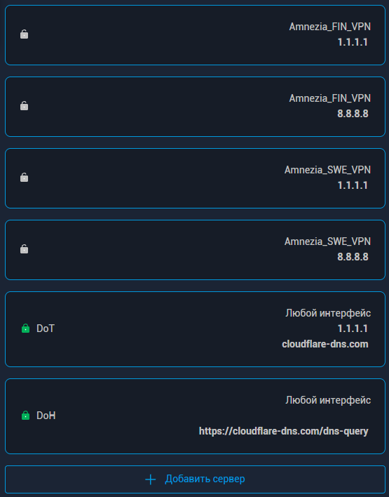
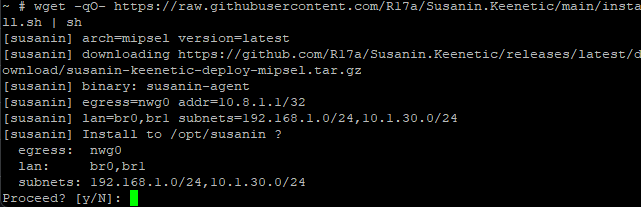
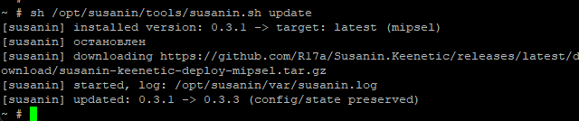

# Susanin.Keenetic

[](src)
[](README.md)
[](README.md)
[](README.md)
[](LICENSE)
[](https://github.com/R17a/Susanin.Keenetic/releases)

[](https://pay.cloudtips.ru/p/dcbf5f2e)
[](https://www.donationalerts.com/r/dmitriy_r17a)
[](https://t.me/Susanin_Keenetic)

> Проект сделан по статье на
> [Habr](https://habr.com/ru/articles/1076620/) и проекту
> [Fiark/susanin](https://github.com/Fiark/susanin) (адаптивная
> VPN-маршрутизация для MikroTik RouterOS), перенесён на роутеры
> Keenetic/Entware.

Адаптивная маршрутизация - программа смотрит, какие соединения «не работают» из-за
блокировок, пробует их через VPN, запоминает рабочие и дальше держит их в VPN.
Если VPN недоступен — всё идёт напрямую. Есть и простой список доменов, которые
должны идти через VPN **всегда** (без ручных списков IP — только имена, как в
Keenetic).

> **Статус: релиз 0.4.0.** Проверено на Keenetic Viva (MT7621, MIPS),
> KeeneticOS 5.1.4–5.1.5, Entware, туннели WireGuard/AmneziaWG (`nwg0`/`nwg1`),
> Xray VLESS+REALITY (`egress_type=tproxy`), Keenetic Giga/Ultra. Работает на
> старых правилах iptables + ipset (nftables на этом ядре нет).

## Что делает

- наблюдает за поведением соединений (conntrack), а не за содержимым;
- по «тихим» признакам блокировок (TCP SYN без ответа, QUIC/UDP без reply,
  TCP-stall, late-stall, DPI-RST) отправляет IP на проверку через VPN;
- подтверждает рабочие направления (кэш `ok`) и держит их в VPN с конечным TTL
  (`ok_ttl`, по умолчанию 6 ч; продлевается, пока идёт трафик), а если маршрут
  через VPN перестал отвечать — снимает сам;
- TCP и UDP/QUIC учит раздельно;
- список доменов «всегда через VPN» (`vpn_always.txt`): эти направления всегда
  идут в туннель; поддерживаются wildcard-зоны `*.example.com`, CIDR и IP;
- список «всегда напрямую» (`vpn_never.txt`, never VPN): домен / IPv4 / CIDR и
  wildcard `*.example.com` — такие направления никогда не уходят в VPN
  (например, `forum.keenetic.ru` или собственный прокси на RU-сервере);
- если сайт ответил по основному каналу, он **не** заворачивается в VPN
  (кандидатами становятся только направления без ответа);
- fail-open: при недоступности туннеля — прямой доступ (DIRECT);
- несколько VPN-подключений: failover на живой + автоматический возврат на
  приоритетный (failback);
- egress может быть **интерфейсом** (`nwg*`, `wdtt*`) или **Xray/VLESS+REALITY**
  (`egress_type=tproxy`, TCP REDIRECT + свой UDP-релей);
- **профили маршрутизации**: до 4 списков «домены/CIDR → свой туннель»;
- **веб-панель** в самом агенте (только LAN): статус, конфиг, списки, профили,
  reload/rescan/restart/reset; по умолчанию выключена;
- автоматически чинит правила, если их снёс NDM (Web-UI change) — reconcile;
- может маршрутизировать и клиентов **OpenConnect-сервера** на этом же роутере
  (интерфейс `oc+`): установщик находит сервер и предлагает добавить его в
  маршрутизацию;
- работает как демон под Entware (`/opt`), управление — CLI/SSH или веб-панель.

Не является VPN-клиентом: туннель (WireGuard/AmneziaWG «Дополнительное
подключение») должен уже работать. IPv6 в v1 не поддерживается.

## Как это устроено (кратко)

- **Смотрим на соединения, а не на содержимое.** Программа читает
  `/proc/net/nf_conntrack` — там видно состояние TCP, сколько пакетов и байт
  ушло и пришло, метки.
- **Правила фильтрации.** Своя цепочка `SUSANIN` в mangle PREROUTING (после
  правил Keenetic). Нужные адреса помечаются через `CONNMARK`/`MARK` и уходят
  в отдельную таблицу маршрутизации (по умолчанию `100`; номер должен быть
  маленьким — busybox `ip` не понимает большие). Адреса хранятся в наборах
  ipset `susanin_{test,ok}_{tcp,udp}`.
- **Таймеры.** Проверки идут по расписанию: FAST 1 с, SOFT 1 с, JUDGE 1 с,
  HEALTH 5 с. «Зависшие» соединения удаляются из conntrack, чтобы клиент
  подключился заново — уже через VPN. Пороги взяты из проекта Susanin.MikroTik.

### Наборы адресов (ipset)

Программа хранит адреса в наборах ipset. Команда `status` показывает, сколько
адресов в каждом наборе (блок «ipset sizes»):

| Набор | Что содержит |
|---|---|
| `susanin_ok_tcp` / `susanin_ok_udp` | подтверждённые адреса — идут через VPN (TCP и UDP/QUIC учатся отдельно) |
| `susanin_test_tcp` / `susanin_test_udp` | адреса, которые сейчас проверяются через VPN |
| `susanin_ok_net` | диапазоны (CIDR) из `vpn_always.txt` |
| `susanin_never` | адреса «всегда напрямую» из `vpn_never.txt` |

Пример: `susanin_ok_tcp = 2682` — столько адресов подтверждено и идёт через VPN.

## Требования

- Keenetic с установленным **Entware**;
- пакеты Entware: `ipset`, `conntrack`, busybox, `iptables` (legacy);
  для скачивания релизов по HTTPS — `ca-certificates` + `wget-ssl` (у BusyBox
  `wget` нет HTTPS);
- работающий VPN-туннель (WireGuard/AmneziaWG) — его интерфейс будет egress,
  либо Xray/VLESS+REALITY (`egress_type=tproxy`, Xray ставится отдельно);
- LAN-интерфейсы (обычно `br0`, `br1`);
- в Keenetic **выключена «Маршрутизация DNS»** (доменные маршруты, которые
  уводят домены в туннель) — иначе Keenetic и Susanin.Keenetic мешают друг другу;

  

- настроен **шифрованный DNS (DoH/DoT)** — на роутере или на клиентах: иначе
  провайдер может подменить ответы DNS, и клиент не получит настоящий адрес
  сайта даже при рабочем VPN (частая причина «YouTube/Claude не открывается»);

  

- root-доступ по SSH.

## Дистрибутив

Готовые сборки — в разделе **Releases** (по архитектурам, вместе с `SHA256SUMS`):
- `susanin-keenetic-deploy-<arch>.tar.gz`, где arch = `mipsel`, `mips`,
  `aarch64`, `armv7`, `x86_64`. Внутри всё для установки: `susanin-agent`,
  `datapath.sh`, `susanin.sh`, `update.sh`, `uninstall.sh`, `install.sh`,
  конфиг, `vpn_always.txt`, `vpn_never.txt`, `www/`, `docs/`;
- `susanin-keenetic_<версия>_<arch>.ipk` — пакет Entware для тех же 5
  архитектур (`opkg install`, обновление через `opkg`, см. ниже).

**Проверено на живом роутере:** Keenetic Viva / KeeneticOS 5.1.4–5.1.5 /
Entware, архитектура **mipsel**. Остальные архитектуры собраны и приложены к
релизам, но на живом железе не проверялись — если что-то не работает, напишите
в Issues.

**Собрать без локального компилятора** — через готовый образ на GitHub:

```sh
docker pull ghcr.io/r17a/susanin.keenetic:latest
docker run --rm -v "$PWD/build:/out" ghcr.io/r17a/susanin.keenetic:latest \
  sh -c 'cp /src/susanin-agent /out/susanin-agent.mipsel'
```

Образ: https://github.com/users/R17a/packages/container/package/susanin.keenetic

Для других архитектур используйте мультиархитектурную сборку
`sh tools/wsl-build.sh mipsel mips aarch64 armv7 x86_64` (см. «Сборка»).

## Домены, которые всегда через VPN

Для заведомо заблокированных сервисов (например, Claude/Anthropic) обучение не
нужно — их можно указать вручную. Список задаётся файлом
`/opt/susanin/etc/vpn_always.txt` (по одному домену, IP или диапазону CIDR на
строку).

Программа сама замечает изменения (перезапуск не нужен): она находит адреса
доменов и добавляет их в наборы `susanin_ok_{tcp,udp}` — все TCP/UDP-соединения
с этими адресами сразу идут через VPN. Подробности:

- путь по умолчанию — `/opt/susanin/etc/vpn_always.txt` (поле
  `vpn_always_file` в конфиге; если файла нет — функция выключена);
- файл перечитывается каждые `vpn_always_interval` (по умолчанию `300` сек),
  адреса обновляются; правки применяются сразу, без перезапуска;
- убрали домен из файла — его адреса снимутся при следующем обновлении (то, что
  уже подтверждено обучением, останется в обычном кэше);
- поддомен указывается отдельной строкой (`sub.example.com`);
- **`*.example.com`** — домен и поддомены: берутся адреса самого домена и
  «пробного» поддомена. Если у поддомена свой отдельный адрес — его найдёт
  обучение (или добавьте `sub.example.com` отдельной строкой);
- если домен есть и в `vpn_always.txt`, и в `vpn_never.txt` (или зоны
  пересекаются, например `*.keenetic.ru` и `forum.keenetic.ru`), приоритет у
  «напрямую»; в лог пишется предупреждение;
- поддерживается только IPv4 (A-записи); диапазоны (`a.b.c.d/n`) добавляются как
  есть; DNS-сервер берётся из `/etc/resolv.conf` или из поля `vpn_always_dns`;
- готовый список идёт в комплекте (`vpn_always.txt`) и ставится в
  `/opt/susanin/etc/vpn_always.txt` **только если файла ещё нет** — при
  установке и обновлении ваш список **не перезаписывается**, но может
  **дополняться** новыми записями из сборки (merge; существующие не удаляются).
  Дополнение выключается флагом `--keep-lists` (см. «Установка / обновление»).
  Проверить: `sh /opt/susanin/tools/susanin.sh status` покажет домены.

## Домены, которые всегда НАПРЯМУЮ (never VPN)

Обратный список — то, что **никогда** не должно идти через VPN (например, свой
прокси на сервере в РФ). Файл `/opt/susanin/etc/vpn_never.txt` (домен, IP или
CIDR), по умолчанию пустой. Поддерживается **`*.example.com`** — домен и все
поддомены (как в `vpn_always.txt`). Если домен есть в обоих списках — приоритет
у «напрямую», в лог пишется предупреждение.

Программа находит адреса доменов и кладёт их в набор `susanin_never`. В цепочке
`SUSANIN` для этого набора стоит `RETURN` **до** правил пометки, поэтому такие
адреса не попадают в `ok`/`test` и всегда идут напрямую. Если адрес ошибочно
попал в VPN-кэш — уберите его командой
`sh /opt/susanin/tools/susanin.sh reset <ip|домен>` (синоним — `forget`).

## OpenConnect VPN на том же роутере

Если на роутере работает **OpenConnect-сервер** (ocserv), его клиенты ходят через
интерфейсы `oc0`, `oc1`, … (по одному на клиента), поэтому в конфиг добавляется
шаблон **`oc+`**, а не конкретный `oc0`. Установщик находит сервер и спрашивает:

```
[susanin] OpenConnect server detected. Add its clients (oc+) to routing? [y/N, или флаг --with-oc]:
```

Ответьте `y` (или `yes`), либо передайте `--with-oc`; `discover`/`rescan` дальше
держат `oc+` сами, пока сервер жив. Что делает установщик при согласии:

- добавляет `oc+` **в конец** `lan_interfaces` (порядок важен: первый интерфейс
  используется для DNS-снифинга и резолва `vpn_always`);
- добавляет подсеть клиентов OpenConnect (например, `172.16.5.0/24`) в
  `lan_subnets` (значение берётся из `ipv4-network` в
  `/var/run/ocserv/ocserv.conf` или из адреса интерфейса);
- после этого трафик клиентов (телефон/ноутбук через OpenConnect)
  обрабатывается так же, как трафик LAN: заблокированное идёт через VPN,
  остальное — напрямую; отдельные правила NAT не нужны.

Если на телефоне через OpenConnect «сайты не открываются» и Chrome пишет
`DNS_PROBE_FINISHED_NXDOMAIN` — Android шлёт DNS на `8.8.8.8`, а сервер не
форсирует DNS в туннель. Включите `dns_hijack=1` (DNS клиентов `oc+`/`wdtt+`
уйдёт на резолвер роутера; `br0`/`br1` не затрагиваются) и перезапустите службу.
Правило ставится **заранее** шаблоном `oc+` и работает, когда телефон подключится
позже; при пропаже правил агент вернёт их сам. Адреса из приватных сетей
(10/8, 172.16/12, 192.168/16) не перехватываются, чужие DNAT-правила не трогаются.

## XRay (VLESS-REALITY) как egress для Susanin.Keenetic

Susanin.Keenetic может выносить помеченный трафик в Xray — режим `egress_type=tproxy`
(альтернатива VPN-интерфейсу из «Других подключений»). Логика Susanin.Keenetic та же
(`vpn_always` + автообучение), меняется только egress:

- **TCP:** `nat REDIRECT` помеченных соединений → Xray `dokodemo-door`
  (`followRedirect`) → VLESS/REALITY;
- **UDP:** релей в самом демоне (`TPROXY` приём + SOCKS5 `UDP ASSOCIATE` к
  локальному Xray `socks`, `udp:true`).

Требуется бинарь Xray и конфиг клиента (Xray в поставку не входит —
скачивается отдельно, ~29 МБ):
```sh
# 1) вместе с установкой: любой способ, флаг --with-xray(-tproxy)
sh bootstrap.sh --with-xray --yes                       # tar-архив
wget -qO- https://raw.githubusercontent.com/R17a/Susanin.Keenetic/main/install.sh \
  | sh -s -- --ipk --with-xray-tproxy                    # пакет .ipk
# 2) вручную: xray/xray.<arch> из репозитория -> /opt/sbin/xray, chmod +x,
#    sha256 сверить с xray/SHA256SUMS
cp /opt/susanin/etc/xray-tproxy.json.example /opt/susanin/etc/xray-tproxy.json
```
В `.ipk` есть `xray-egress.sh`, init-скрипт `S93xray-tproxy` и шаблон
`share/xray-tproxy.json.example`; самого бинаря Xray в пакете нет (он большой и
нужен только для этого режима) — установщик скачивает его из репозитория и
проверяет SHA256; сеть недоступна — подскажет, куда положить файл вручную.
Включение/выключение боевого режима (ключи `egress_type=tproxy`, `udp_relay=1`
и т.д. выставляются автоматически):
```sh
sh /opt/susanin/tools/xray-egress.sh enable     # ok/vpn_always -> XRay
sh /opt/susanin/tools/xray-egress.sh restart    # перезапуск только Xray+агента
sh /opt/susanin/tools/xray-egress.sh disable    # обратно в DIRECT
```
TCP/UDP проверяются безопасным тестом одного адреса:
`xray-egress.sh run 1.1.1.1 both` (см. [XRAY.md](XRAY.md)).

> Обычный режим (`egress_type=interface`, VPN из «Других подключений», `nwg*`)
> сохранён и не изменён. XRay и XKeen одновременно использовать не нужно; для
> XRay используйте встроенный tproxy-режим Susanin.Keenetic.
>
> **Резервный путь «интерфейс → Xray» делается штатно, средствами движка:** в
> `egress_interface` добавляется кандидат `tproxy` (например
> `egress_interface=nwg1,tproxy`) — см. таблицу полей конфига ниже. Отдельный
> внешний наблюдатель (`egress-failover.sh`) в поставку **не входит** и не нужен:
> два механизма одновременно конфликтуют. Если очень нужен ручной «аварийный»
> переключатель — он остаётся в репозитории как dev-инструмент.

## Вместе с qWDTT_Server_Keenetic

qWDTT поднимает серверные туннели `wdtt0`/`wdttraw0` и NAT-ит клиентов сетей
`10.66.66.0/24` / `10.70.66.0/16` «по источнику». Чтобы проекты не мешали друг
другу:

- `wdtt0`/`wdttraw0` не должны попадать в `lan_interfaces`/`lan_subnets` и уж
  тем более в `egress_interface` — они внесены в `discover_exclude` (по
  умолчанию `wdtt0,wdttraw0,tun0,tap0`);
- VPN-подсеть Susanin.Keenetic (`egress_address`) не должна пересекаться с сетями qWDTT
  (пример безопасного набора: Susanin.Keenetic `10.8.1.0/24`, qWDTT `10.66.66.0/24`);
- один решающий механизм на клиента: клиентами qWDTT Susanin.Keenetic не занимается (у
  них свой NAT), а LAN-клиенты идут через Susanin.Keenetic.

`diagnose.sh` обнаруживает qWDTT (интерфейсы, цепочки, хук) и предупреждает о
конфликтах.

### Если клиенты qWDTT должны идти через Susanin.Keenetic

По умолчанию Susanin.Keenetic клиентами qWDTT **не занимается** (это
совместимость, а не интеграция). Если нужно завернуть их в свой egress,
включите штатную поддержку «LAN-серверов»:

```sh
# /opt/susanin/etc/susanin.conf
lan_server_interfaces=wdtt0,wdttraw0
mss_clamp=pmtu          # обязательно: туннель 1280-в-1280 иначе упрётся в PMTU
sh /opt/susanin/tools/susanin.sh rescan    # перенесёт wdtt* в lan_interfaces
sh /opt/susanin/tools/susanin.sh restart
```

Что важно знать:

- это **двойной туннель**: клиент qWDTT → сервер qWDTT → Susanin.Keenetic → VPN.
  Скорость будет ниже, а `mss_clamp` (`pmtu` или `mss_clamp_lan=1`) обязателен —
  без него крупные пакеты не пройдут и страницы будут открываться частично;
- `ipv6_block` и `quic_block` действуют только на интерфейсы из
  `lan_interfaces` — на клиентов qWDTT они не распространяются;
- политики Keenetic (`ip rule` 100–107 с `fwmark 0xffffaXX` → таблицы
  4096/4098/4100/4102) могут перебивать нашу метку — проверьте
  `ip rule show` и `ip route show table 4096` при подключённом клиенте;
- обратно: `lan_server_interfaces=` (пусто) + `rescan` возвращает прежнее
  поведение «не трогаем клиентов qWDTT».

`diagnose.sh` различает эти случаи: если `wdtt*` попали в `lan_interfaces`
именно из-за `lan_server_interfaces`, предупреждения «уберите wdtt*» не будет —
вместо него проверяется `mss_clamp`.

## Профили маршрутизации (экспериментально)

Кроме адаптивного обучения, можно задать **статические профили**: список
(домены / IP / CIDR) принудительно уходит в **свой** туннель, со своими меткой и
таблицей маршрутизации. Это отдельный слой поверх Susanin.Keenetic (своя цепочка
`SUSANIN_PROFILES`, свои метки/таблицы), по умолчанию **выключен**.

Профилей может быть несколько (до `CFG_MAX_PROFILES = 4`). В `susanin.conf` они
задаются повторяющимися ключами с индексом `1..4`: `profile1_*`, `profile2_*`, …
Профиль включается, только если задан `profileN_name`; всё остальное для него —

| Ключ | Смысл | По умолчанию |
|---|---|---|
| `profileN_name` | имя профиля (включает его); `[a-z0-9_]` | — |
| `profileN_egress` | интерфейс(ы) туннеля через запятую; берётся первый живой | — |
| `profileN_list` | файл списка (домены / IP / CIDR, по строке) | — |
| `profileN_geo_url` | ссылка на скачиваемый CIDR-список; кэш в `var/profiles/` | — |
| `profileN_auto` | автообучение: подтверждённые адреса из диапазона профиля пинятся в его набор | `0` |
| `profileN_table` | номер таблицы маршрутизации | `201..204` по индексу |
| `profileN_mark` | fwmark профиля | `0x40000000,0x08000000,0x04000000,0x02000000` |

Пример на два профиля (разные списки → разные туннели):
```
profile1_name=cdn
profile1_egress=nwg1
profile1_list=/opt/susanin/etc/profiles/cdn.txt

profile2_name=social
profile2_egress=nwg2
profile2_list=/opt/susanin/etc/profiles/social.txt
```
Файлы списков создаются вручную: `/opt/susanin/etc/profiles/<name>.txt`
(по строке — домен, IP или CIDR; `#` — комментарий). Домены резолвятся в IP.

Управление:
```sh
sh /opt/susanin/tools/profiles.sh up       # применить (идемпотентно)
sh /opt/susanin/tools/profiles.sh status   # что поднято (имя, egress, table, mark, записей)
sh /opt/susanin/tools/profiles.sh refresh  # перечитать списки/geo_url, не пересобирая правила
sh /opt/susanin/tools/profiles.sh down     # снять
```
Профиль можно задать и отдельным файлом
`/opt/susanin/etc/profiles.d/<имя>.conf` (те же поля). Если задан
`profile_failover=1`, агент держит таблицу профиля на первом живом туннеле из
списка. Профили поднимаются автоматически при старте демона (`S94susanin`);
если ни одного `profileN_name` нет — ничего не меняется.

Важные детали:
- адрес обрабатывается **первым совпавшим** профилем (правила идут по порядку);
- `profileN_table`/`profileN_mark` можно не задавать — берутся значения по
  умолчанию; задавайте вручную только если они уже заняты;
- список профиля задаётся ключами или файлом; автообучение (`profileN_auto`) и
  фейловер профиля (`profile_failover`) поддерживаются.

Что важно знать (обновлено для 0.4.0):

- **`reload` применяет профили** (с 0.4.0): после правки конфига или сохранения в
  панели достаточно `susanin.sh reload`; `profiles.sh up` остаётся для ручного
  применения;
- **профиль приоритетнее основной схемы** (с 0.4.0): его цепочка стоит первой в
  PREROUTING, в основной цепочке для адресов профиля ставится `RETURN`, а метка
  профиля дублируется в `CONNMARK` — адрес, выученный ранее, уходит в профиль, а
  не в основной туннель;
- **`profileN_mark` по умолчанию разные** у профилей 1–4
  (`0x40000000/0x08000000/0x04000000/0x02000000`), вручную задавать не нужно;
- **туннель профиля с MTU < 1500 требует `mss_clamp`**: ставьте `mss_clamp=pmtu`
  (или число ≤ MTU−40), иначе рукопожатие проходит, а страница «висит»;
- проверка «сработал ли профиль» — счётчик пакетов на правиле метки
  (`iptables -t mangle -vnL SUSANIN_PROFILES`): профиль ставит метку пакета, в
  `/proc/net/nf_conntrack` её не видно;
- для сервисов с ротацией адресов (Google/Gemini/Cloudflare) лучше
  `profileN_geo_url`, чем список доменов: браузер резолвит через DoH и получает
  другие IP, чем `nslookup` на роутере.

Смотрите также «Вместе с qWDTT_Server_Keenetic» и [XRAY.md](XRAY.md).

## Веб-панель (только LAN)

В агенте есть встроенный мини-HTTP-сервер — отдельный процесс `susanin-agent web`,
внешний httpd/lighttpd не нужен. По умолчанию **выключен**.

```sh
# /opt/susanin/etc/susanin.conf
web_enable=1
web_listen=192.168.1.1     # только LAN-адрес роутера, не 0.0.0.0
web_port=8087
web_token=                 # пусто = вход без пароля (доступ только из LAN)
```

```sh
sh /opt/susanin/tools/susanin.sh web restart
# затем в браузере: http://192.168.1.1:8087/
# с токеном:      http://192.168.1.1:8087/?token=ВАШ_ТОКЕН (ставит cookie)
```

Что умеет: статус (egress/health, размеры наборов, профили, память), правка
конфига, списки `vpn_always`/`vpn_never` (drag&drop и Memo-редактор всего файла),
профили, действия Reload/Rescan/Restart/Reset. Если на GitHub есть более новый
релиз, рядом с версией в шапке появляется оранжевый знак «!» с подсказкой
«Есть обновление до версии …»; клик открывает страницу релиза. Проверка идёт не
чаще `release_check_interval` (по умолчанию 12 ч), результат кэшируется в
`/opt/susanin/var/release.state`, отключается ключом `release_check=0`.
Токен сравнивается за постоянное время; `?token=` принимается только для первого
GET; без TLS — при необходимости ставьте панель за своим прокси или не
выставляйте её в недоверенный сегмент.

## Важно: «Приоритеты подключений» Keenetic и Susanin.Keenetic

Keenetic умеет сам направлять устройства и сегменты в VPN (Web →
**«Приоритеты подключений»**). Это **отдельный механизм**: его правила идут с
приоритетом 100–107, а правила Susanin.Keenetic — 2000/2001. Поэтому для клиента,
привязанного к политике Keenetic, весь трафик идёт по решению Keenetic (в VPN
или напрямую — зависит от политики), а списки и обучение Susanin.Keenetic на него
**не действуют**.

Простое правило: **у каждого клиента должен быть один «решающий» механизм.**

- Хотите, чтобы решал Susanin.Keenetic (что через VPN, что напрямую) — у клиента или
  сегмента **не должно быть назначено никакой политики** (оставьте системную
  «по умолчанию»). Это про **любую** политику: названия задаёте вы сами, и
  любая назначенная политика перекрывает Susanin.Keenetic. Например, при политике
  «только напрямую» заблокированный сайт не откроется, и Susanin.Keenetic не сможет
  завернуть его в VPN.
- Хотите «всё и всегда через VPN» — можно назначить политику Keenetic, но тогда
  списки и обучение Susanin.Keenetic для этого клиента не работают.
- Смешивать оба для одного клиента нельзя.

Проверить привязки:

```sh
ndmc -c "show running-config" | grep -i "ip policy"
```
(или Web → «Приоритеты подключений»).

Как понять по conntrack, кто управляет клиентом:
- `mark=2684xxxxx` (`0xffffaXX`) — клиент под политикой Keenetic, Susanin.Keenetic его не
  обрабатывает;
- `mark=0` или `mark=536870912` (`0x20000000`) — работает Susanin.Keenetic (напрямую или
  через VPN).

## Установка / обновление / удаление

### Пакетом Entware `.ipk` (0.4.0+, рекомендуется)

Сначала зависимости: `ca-certificates` + `wget-ssl` нужны, чтобы скачать пакет по
HTTPS (у BusyBox-wget его нет); остальное (`ipset`, `iptables`, `conntrack`)
`opkg` подтянет сам из `Depends` пакета:

```sh
opkg update && opkg install ca-certificates wget-ssl
```

**Способ 1 — установщик сам определит архитектуру и поставит пакет**:

```sh
wget -qO- https://raw.githubusercontent.com/R17a/Susanin.Keenetic/main/install.sh | sh -s -- --ipk
```

> Пакет установщик берёт из последнего релиза (`v0.4.0`) и сверяет SHA256 по
> `SHA256SUMS` из релиза. Ответ `ERROR: unknown arg: --ipk` означает, что взят
> старый скрипт (кэш или ветка до 0.4.0).

Что делает `--ipk`: определяет архитектуру Entware (`opkg print-architecture`,
нормализация `mipsel-3.4` → `mipsel` и т.д.), скачивает
`susanin-keenetic_<версия>_<arch>.ipk` из релиза в `/opt/tmp`, сверяет SHA256 по
`SHA256SUMS` из этого же релиза (не совпало — установка отменяется) и выполняет
`opkg install` (с `--force` — `opkg install --force-reinstall`).
Флаги: `--version v0.4.0` (без него — последний релиз), `--force`
(переустановить), `--yes` (без вопросов), `--arch mipsel|mips|aarch64|armv7|x86_64`
(если автоопределение не сработало), `--with-xray-tproxy` — режим VLESS/REALITY:
скачает Xray в `/opt/sbin/xray`, сверит SHA256 и положит шаблон tproxy-конфига
(см. «XRay как egress»).
С `curl` вместо `wget -qO- … | sh` — `curl -fsSL … | sh -s -- --ipk`.

```sh
# VLESS/REALITY пакетом: Xray в .ipk не входит, установщик скачает его отдельно
wget -qO- https://raw.githubusercontent.com/R17a/Susanin.Keenetic/main/install.sh \
  | sh -s -- --ipk --with-xray-tproxy
```

**Способ 2 — вручную**, если нужен контроль над файлом. Сначала посмотрите
архитектуру Entware и выберите файл:

```sh
opkg print-architecture | awk '{print $2}'
```

| Архитектура Entware | Файл из релиза |
|---|---|
| `mipsel-3.4` (MT7621: Viva, Giga, Ultra и т.п.) | `susanin-keenetic_0.4.0_mipsel-3.4.ipk` |
| `mips-3.4` | `susanin-keenetic_0.4.0_mips-3.4.ipk` |
| `aarch64-3.10` | `susanin-keenetic_0.4.0_aarch64-3.10.ipk` |
| `armv7sf-k3.2` | `susanin-keenetic_0.4.0_armv7sf-k3.2.ipk` |
| `x86-64` | `susanin-keenetic_0.4.0_x86-64.ipk` |

Скачивание, **проверка суммы и только потом установка** (подставьте свой файл из
таблицы; в имени и в URL — одна и та же версия):

```sh
mkdir -p /opt/tmp && cd /opt/tmp
wget -O susanin-keenetic_0.4.0_mipsel-3.4.ipk \
  https://github.com/R17a/Susanin.Keenetic/releases/download/v0.4.0/susanin-keenetic_0.4.0_mipsel-3.4.ipk
wget -O SHA256SUMS \
  https://github.com/R17a/Susanin.Keenetic/releases/download/v0.4.0/SHA256SUMS
sha256sum -c SHA256SUMS 2>/dev/null | grep mipsel-3.4   # ожидаем: ...: OK
opkg install susanin-keenetic_0.4.0_mipsel-3.4.ipk
susanin version && susanin status && susanin diagnose
```

Если `wget` без HTTPS (BusyBox) — вместо `wget -O …` используйте
`curl -fL -o …` с тем же адресом. Для новой версии замените `0.4.0`
(и `v0.4.0` в URL) на её номер.

Пакет ставит демон, скрипты, init-скрипты Entware, веб-панель и документацию в
`/opt/susanin`. Конфиг (`susanin.conf`), списки `vpn_always`/`vpn_never`,
состояние и профили при обновлении **не перезаписываются**; при первой установке
конфиг создаётся из `config.example.conf` — проверьте в нём `egress_interface` и
`lan_interfaces`. Обновление = `opkg install` нового `.ipk`; удаление:

> Если стоит `0.4.0.RC1.Hotfix`, opkg считает `0.4.0` **понижением**
> (`0.4.0` < `0.4.0.RC1.Hotfix`) и откажется ставить. Свежий `install.sh`
> добавляет `--force-downgrade` сам; вручную —
> `opkg install --force-downgrade susanin-keenetic_0.4.0_<arch>.ipk`.
> Альтернатива без opkg: `sh /opt/susanin/tools/susanin.sh update v0.4.0`.

```sh
opkg remove susanin-keenetic      # служба, init и правила снимаются; данные остаются
rm -rf /opt/susanin               # если нужно удалить и конфиг/списки/состояние
```

Сборка пакетов — `tools/make-ipk.sh` (см. «Сборка»); `.ipk` прикладываются к
релизам рядом с tar-архивами.

### Скриптом (tar-архив)

Сначала поставьте нужные пакеты Entware: сертификаты и `wget-ssl` — чтобы `wget`
скачал релиз по HTTPS (у BusyBox-wget HTTPS нет), и зависимости — `ipset`,
`iptables`, `conntrack`:

```sh
opkg update && opkg install ca-certificates ipset iptables conntrack wget-ssl
```

Установка **одной строкой**: `install.sh` скачает из релиза архив под вашу
архитектуру (`susanin-keenetic-deploy-<arch>.tar.gz`), распакует, автоматически
определит LAN и VPN, затем спросит подтверждение:

```sh
wget -qO- https://raw.githubusercontent.com/R17a/Susanin.Keenetic/main/install.sh | sh
```

Либо поставьте curl и используйте его:
```sh
opkg install curl
curl -fsSL https://raw.githubusercontent.com/R17a/Susanin.Keenetic/main/install.sh | sh
```

Установка идёт с ветки `main` — это стабильная версия; установщик сам скачает
архив последнего стабильного релиза под вашу архитектуру.

Архитектура определяется автоматически по данным Entware
(`/opt/etc/entware_release`, затем фид из `/opt/etc/opkg.conf`, затем
`opkg print-architecture`, затем `uname -m` + endianness ELF-заголовка).
Дополнительные флаги:
`--arch mipsel|mips|aarch64|armv7|x86_64` (задать вручную),
`--version latest|vX.Y.Z`, `--egress <if>`, `--lan <if,if>`,
`--subnets <cidr,cidr>`, `--yes` (без подтверждений), `--force`
(перезаписать `susanin.conf`), `--no-start`, `--prefix <dir>`,
`--keep-lists` (не трогать существующие `vpn_always.txt`/`vpn_never.txt`).

Подтверждения (`[y/N]`) можно либо отвечать вручную (`y` или `yes`), либо
заранее передать `--yes` (`-y`) и не отвечать ни на что.

Установка из распакованного архива (без интернета):
```sh
sh install.sh --yes
```

Старые BusyBox (где `tar` не знает `--exclude`) — установщик `bootstrap.sh`: сам
определит arch/ядро, скачает архив и распакует только бинарник под вашу
архитектуру. Тот же `bootstrap.sh` умеет ставить пакетом (`--ipk`) и добавлять
Xray (`--with-xray`):

```sh
cd /opt/tmp
wget -qO- https://raw.githubusercontent.com/R17a/Susanin.Keenetic/main/bootstrap.sh | sh -s -- --yes
# пакетом:           sh -s -- --yes --ipk
# пакетом + Xray:    sh -s -- --yes --ipk --with-xray
# tar-архив + Xray:  sh -s -- --yes --with-xray
```
По умолчанию берётся **последний релиз** (`--channel stable`), сейчас это
`v0.4.0`; конкретную версию задаёт `--version v0.4.0`. dev-канал отключён —
тестовые архивы больше не публикуются.

Флаги: `--channel stable|dev`, `--version`, `--file`, `--url`, `--check`,
`--dry-run`, `--ipk`, `--with-xray`, `--verify`, `--tmp DIR`; остальные
(`--yes`, `--arch`, `--egress`, `--lan`, `--force`, `--deps`, `--keep-lists`)
передаются в `install.sh`.

Ваши `/opt/susanin/etc/susanin.conf`, `vpn_always.txt` и `vpn_never.txt` при
установке и обновлении **не перезаписываются**, но списки могут **дополняться**
новыми записями из сборки (merge; существующие строки не удаляются). Чтобы
обновление не касалось списков вообще, добавьте флаг `--keep-lists`:

```sh
sh /opt/susanin/tools/susanin.sh update v0.4.1 --keep-lists
sh install.sh --keep-lists          # то же для установки
```

Если на роутере есть **OpenConnect-сервер (ocserv)** и его интерфейс (`oc0`) не
в маршрутизации, установщик спросит (по-английски), добавить ли его:
`OpenConnect server detected (oc0). Add it to Susanin.Keenetic routing? [y/N]`.
Ответьте `y`; при `--yes` добавится сам.



**Обновление** (конфиг и состояние сохраняются):

```sh
# пакетом (если ставили .ipk):
opkg install /opt/tmp/susanin-keenetic_0.4.0_mipsel-3.4.ipk   # или opkg upgrade при включённом фиде

# скриптом (tar-архив):
sh /opt/susanin/tools/susanin.sh update 0.4.0    # или `susanin update 0.4.0`; latest = последний релиз

# то же, но списки vpn_always.txt / vpn_never.txt не трогать вообще:
sh /opt/susanin/tools/susanin.sh update 0.4.1 --keep-lists
```

> `susanin.sh update` сам определяет установленную версию и архитектуру, скачивает
> deploy-архив из Releases, **сохраняет** `susanin.conf`, списки и `susanin.state`,
> дописывает новые ключи/списки и перезапускает службу. Обновление `.ipk` делает
> `opkg` (данные тоже не перезаписываются).
>
> `--keep-lists` (синоним `--no-lists`) отключает только автодополнение списков:
> `vpn_always.txt` и `vpn_never.txt` остаются ровно такими, какие они есть.
> Бинарь, `tools/`, `www/` и конфиг обновляются как обычно; обратный флаг —
> `--lists` (поведение по умолчанию).



**Удаление**:

```sh
sh /opt/susanin/tools/susanin.sh uninstall          # остановить и снять правила/автозапуск, конфиг и состояние оставить
sh /opt/susanin/tools/susanin.sh uninstall --purge  # удалить /opt/susanin полностью
```

В релизах публикуются архивы `susanin-keenetic-deploy-<arch>.tar.gz`
(mipsel/mips/aarch64/armv7/x86_64) и `SHA256SUMS`.

Если нужно настроить правила вручную:
```sh
sh /opt/susanin/tools/susanin.sh install    # datapath up + setup
# либо явно:
/opt/susanin/bin/susanin-agent setup --egress nwg0 --lan br0,br1 --table 100
```

**Управление демоном:**

| Действие | Команда |
|---|---|
| Запуск | `sh /opt/susanin/tools/susanin.sh start` |
| Остановка | `sh /opt/susanin/tools/susanin.sh stop` |
| Перезапуск | `sh /opt/susanin/tools/susanin.sh restart` (веб-панель не затрагивается) |
| Веб-панель | `sh /opt/susanin/tools/susanin.sh web {start\|stop\|restart\|status}` |
| Состояние | `sh /opt/susanin/tools/susanin.sh status` (показывает `daemon:` и `web:`) |
| Лог | `sh /opt/susanin/tools/susanin.sh log` |
| Версия | `sh /opt/susanin/tools/susanin.sh version` (то же, что `susanin-agent version`) |
| Снять правила | `sh /opt/susanin/tools/susanin.sh down` |
| Убрать IP/домен из кэша | `sh /opt/susanin/tools/susanin.sh reset <ip|домен>` (синоним `forget`) |
| Обновление | `sh /opt/susanin/tools/susanin.sh update 0.4.0` (или `latest`); без правки списков — `… update 0.4.1 --keep-lists` |
| Удаление | `sh /opt/susanin/tools/susanin.sh uninstall [--purge]` |
| Добавить IP в VPN вручную | `sh /opt/susanin/tools/susanin.sh add <ip> tcp test` |

## CLI

Короткий диспетчер (симлинк `/opt/bin/susanin`, его ставит установщик):
```sh
susanin version          # точная версия сборки (то же, что susanin-agent version)
susanin status           # состояние службы, правил и таблицы
susanin check            # состояние датаплейна
susanin diagnose         # окружение, правила, списки, рекомендации
susanin report           # полный отчёт в /opt/susanin/var/report.txt
susanin restart | reload | rescan
```

Сам агент (`/opt/susanin/bin/susanin-agent`) — расширенный набор:
```
susanin-agent version
susanin-agent discover
susanin-agent setup [--egress <if>] [--lan <if,...>] [--table <n>]
susanin-agent status
susanin-agent apply [--dry-run]
susanin-agent ct-scan
susanin-agent datapath {up|down|status|flush|add|del}
susanin-agent run
susanin-agent install | uninstall
```

## Сборка

Кросс-компиляция в MIPS (mipsel, static) — через WSL или Docker:

```sh
# WSL (Debian/Ubuntu):
sudo apt-get install -y gcc-mipsel-linux-gnu make file
sh tools/wsl-build.sh            # -> build/susanin-agent.mipsel

# Docker:
docker build -f Dockerfile.cross -t susanin-build .
```

## Конфиг (важные поля)

`/opt/susanin/etc/susanin.conf`:

Длительности указываются числом без букв; единица измерения (сек / мин / ч)
написана в описании поля в самом конфиге.

| Поле | Назначение | По умолчанию |
|---|---|---|
| `egress_interface` | VPN-интерфейс(ы); несколько через запятую = фейловер + failback. Можно указать `tproxy` (синоним `xray`) — резервный путь через Xray: проверяется SOCKS-пробой, при переключении датаплейн пересобирается в tproxy-режиме | `nwg0` |
| `egress_type` | `interface` (обычный туннель) или `tproxy` (Xray VLESS+REALITY) | `interface` |
| `egress_address` | адрес(а) туннеля, по порядку с `egress_interface` | `10.8.1.1` |
| `egress_failback` / `egress_failback_debounce` | возврат на приоритетный туннель, когда он снова жив; пауза стабильности, сек | `1` / `30` |
| `lan_interfaces` / `lan_subnets` | LAN, трафик которых анализируем. При OpenConnect-сервере добавьте в конец `oc+` (`discover`/`rescan` держат его сами); серверные туннели qWDTT — в `lan_server_interfaces` | `br0,br1` |
| `routing_table` | номер таблицы (должен быть малым) | `100` |
| `ok_ttl` | срок жизни подтверждённых адресов, сек; `0` = бессрочно (не рекомендуется: наборы растут) | `21600` (6 ч) |
| `fast_syn_min_op` | сколько SYN без ответа нужно для срабатывания | `2` (`1` = быстрее) |
| `learn_exclude_ports` | порты, где отключено быстрое обучение (сетевой шум) | `22,23,53,135,137,138,139,445,554,…` |
| `health_probe` / `health_interval` | адреса проверки туннеля и период, сек | `1.1.1.1,8.8.8.8` / `5` |
| `vpn_always_file` | файл «всегда через VPN» (нет файла = выключено) | `/opt/susanin/etc/vpn_always.txt` |
| `vpn_always_interval` | как часто перечитывать и обновлять список, сек | `300` |
| `vpn_always_dns` | DNS-сервер для списка (пусто = LAN-адрес роутера/из resolv.conf) | (пусто) |
| `vpn_always_cdn_prefix` | пинить CDN-префикс для адресов из ALWAYS (ротация edge-ов у Cloudflare); 0 = только сам адрес | `0` |
| `vpn_never_file` | файл «всегда напрямую» (нет файла = выключено) | `/opt/susanin/etc/vpn_never.txt` |
| `vpn_never_interval` | как часто перечитывать и обновлять список, сек | `300` |
| `ok_max_entries` | предел числа записей кэша на протокол (0 = без предела) | `4096` |
| `ok_evict_misses` | сколько подряд «сбоев» до снятия адреса из `ok` (гистерезис; 1 = сразу) | `3` |
| `dns_sniff` / `dns_sniff_iface` | зеркальный захват DNS (домен → IP); пусто = все LAN-интерфейсы | `0` / (пусто) |
| `dns_hijack` / `dns_hijack_target` | DNAT 53 для клиентов серверных VPN (`oc+`/`wdtt+`); `br0`/`br1` не трогаются; цель пусто = LAN-адрес роутера | `0` / (пусто) |
| `ipv6_block` | блокировать IPv6 из LAN, чтобы клиенты шли по IPv4 под Susanin | `1` |
| `quic_block` | запретить QUIC (UDP 443) из LAN — приложения идут по TCP через туннель | `1` |
| `mss_clamp` / `mss_clamp_lan` | MSS-кламп: `0` / число / `pmtu`; `1` — на весь LAN-forward | `0` / `0` |
| `disk_mode` | `normal` (лог/состояние/бэкапы) или `soft` (минимум записей) | `normal` |
| `soft_state_interval` | как часто сохранять состояние в `soft`, ч (0 = никогда) | `12` |
| `web_enable` / `web_listen` / `web_port` | встроенная веб-панель: включить, LAN-адрес, порт | `0` / `192.168.1.1` / `8087` |
| `web_token` | токен панели; пусто = вход без пароля (только LAN) | (пусто) |
| `release_check` / `release_check_interval` | проверять новые релизы на GitHub и показывать «!»; период, сек (0 = не проверять) | `1` / `43200` |
| `xray_loglevel` | уровень логов Xray (`debug`/`info`/`warning`/`none`) | `warning` |

Про `learn_exclude_ports`: для этих портов отключено только **быстрое**
обучение — детект «одиночный запрос без ответа» (так выглядит сетевой шум и
сканирования), поэтому они не пополняют кэш. Потоки с ответами, которые затем
тормозят, по-прежнему обучаются. На маршрутизацию это не влияет: обрабатываются
все порты, а адреса из `vpn_always.txt` / `vpn_never.txt` и уже выученные идут
как обычно. Если заблокированный сервис работает на таком порту — добавьте его
домен/IP в `vpn_always.txt` (список не зависит от порта) или уберите порт из
`learn_exclude_ports`.

### Несколько VPN-подключений (фейловер)

Если указать несколько интерфейсов (например, `egress_interface=nwg0,nwg1`,
адреса — по порядку), программа проверяет активный туннель и при обрыве
переключает VPN-таблицу на следующий живой, разрывая соединения с VPN-меткой —
чтобы клиент подключился через живой туннель. Когда живых не осталось — всё
идёт напрямую. Источник для проверок берётся из соответствующего
`egress_address`.

### Режим `disk_mode` (сколько писать на носитель)

- `normal` — обычный режим (по умолчанию при установке на USB/флешку): ведётся
  лог-файл, состояние сохраняется раз в 5 минут, делаются бэкапы.
- `soft` — режим экономии (установщик включает его при установке во внутреннюю
  память роутера): лог-файл не ведётся, бэкапы не создаются, а состояние
  сохраняется редко — раз в `soft_state_interval` (по умолчанию 12 часов).

### Диагностика

Если что-то работает не так — запустите скрипт диагностики: он проверит окружение,
настройки, правила и списки, а в конце выдаст **рекомендации**:

```sh
sh /opt/susanin/tools/diagnose.sh
```

Если проблема накопительная («через сутки становится хуже», «растёт память») —
запустите суточный прогон с метриками и приложите лог:

```sh
sh /opt/susanin/tools/soak.sh &          # интервал 60 c, файл var/soak.log
tail -f /opt/susanin/var/soak.log        # Ctrl-C -> сводка с ростом КБ/ч
```

Что выявляет:

- нет `susanin-agent` или пакетов `iptables`/`ipset`/`conntrack`/`ip` — правила
  не создаются вообще;
- `egress_interface` указывает на отсутствующий VPN-интерфейс (подключение
  удалили или переименовали);
- нет цепочки `SUSANIN`, `ip rule` или `default` в таблице VPN — трафик идёт
  мимо туннеля;
- клиенты привязаны к «Приоритетам подключений» Keenetic (видны правила
  `fwmark 0xffffaXX`) — таких клиентов Susanin.Keenetic не обрабатывает;
- наборы `susanin_ok_*` пусты — автообучение не работает;
- в списках: домены без A на apex (для CDN нужны поддомены или `*.domain`),
  неразрешимые имена, конфликты `always`/`never`;
- пустой `vpn_always_dns` (резолвер из системы) — риск подмены DNS.

Для отправки полного отчёта (логи, состояние) используйте
`sh /opt/susanin/tools/report.sh`.

## Известные ограничения v1

- только IPv4 (для тестеров с реальным IPv6-uplink есть `ipv6_block=1`);
- первое открытие «нового» адреса чуть медленнее (обучение по факту);
- busybox-`ip`: номер таблицы должен быть малым, `ip rule` — через `lookup`;
- при пересборке правил Keenetic (любое изменение в Web) программа сама
  восстанавливает свои правила в течение ~15 секунд (tproxy-правила — за ~5 с);
- клиент или сегмент, привязанный к **любой** политике Keenetic («Приоритеты
  подключений»), обходит Susanin.Keenetic — для него списки и обучение не работают
  (см. раздел «Важно: «Приоритеты подключений» Keenetic и Susanin.Keenetic»);
- веб-панель работает по HTTP и только в LAN: наружу не выставляйте, для внешнего
  доступа — через свой VPN/прокси;
- `dns_sniff` и `dns_hijack` покрывают DNS, который идёт по IPv4/UDP/TCP через
  роутер; DoH/DoT внутри туннеля к внешнему резолверу не перехватывается.

## Документы

- [CHANGELOG.md](CHANGELOG.md) — что нового по версиям;
- [USER_GUIDE.md](USER_GUIDE.md) — руководство: быстрый старт, задачи, настройки;
- [TROUBLESHOOTING.md](TROUBLESHOOTING.md) — если что-то не работает;
- [DEPLOY.md](DEPLOY.md) — установка/обновление/удаление на роутере;
- [XRAY.md](XRAY.md) — XRay/VLESS-REALITY и Susanin.Keenetic: совместимость, конфликты, XKeen;
- `tools/susanin.sh`, `tools/datapath.sh` — управление демоном и правилами.

## Благодарности

Спасибо людям, которые помогали проекту — тестированием на своих роутерах,
отчётами с логами, разбором проблем и предложениями по улучшению:

- **Gave_Karen**
- **pegakmop**
- **NJmist**

Ваши отчёты (conntrack, `iptables`, `diagnose.sh`) — то, без чего большинство
исправлений в этом репозитории просто не нашлось бы. Спасибо!

## Поддержать проект

Проект развивается на энтузиазме. Если он оказался полезным — можно поддержать
разработку:

<p align="center">
  <a href="https://www.donationalerts.com/r/dmitriy_r17a"></a>
  &nbsp; &nbsp; &nbsp; &nbsp;
  <a href="https://pay.cloudtips.ru/p/dcbf5f2e"></a>
</p>

## Дисклеймер

Проект не связан и не аффилирован с Keenetic, Amnezia, WireGuard, MikroTik или
авторами упомянутых сторонних проектов. Используйте на свой страх и риск —
сделайте резервную копию конфигурации роутера.

## Лицензия

MIT — см. [LICENSE](LICENSE).
